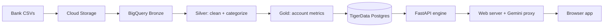

# ChequeMate

**Don't let a layoff checkmate your finances.**

ChequeMate is a financial resilience engine built on real bank customer data for the **Tangerine Track at the Sheridan Datathon 2026**. Pick any account and it shows that customer's income, bills, savings buffer and **runway** (how many months their money would last), applies shocks like a job loss, higher bills or a surprise repair, and builds a savings plan from that customer's own numbers.

**Live demo: [chequemate.work](https://chequemate.work)**

---

## The big finding: the Paycheque Paradox

A bigger paycheque doesn't buy more time. If every customer were laid off and received EI at 55% of income:

| Income quarter | Typical income | Spends | Buffer lasts | Out of money within 6 months |
| --- | --: | --: | --: | --: |
| Lowest | $2,186 | 69% | 8.4 months | 4% |
| Highest | $17,533 | 96% | 1.9 months | 68% |

- Account **28754** brings in **$14,148** a month and lasts **4.7 months**.
- Account **35412** brings in **$2,859** a month and lasts **41.3 months**.

Income tells you how much flows through an account. Runway tells you how long someone can last. Runway also predicts real loan defaults better than income does (**AUC 0.72 vs 0.62**).

**Other findings**

- Joint accounts with a loan defaulted **0 of 145** times; solo accounts defaulted **76 of 537** times.
- Every defaulted loan had a day below zero first.
- January spending runs **45%** above an average month.

---

## What you can do in the app

| Page | What it does |
| --- | --- |
| **Findings** | The Paycheque Paradox, the income-quarter breakdown, a scatter of 900 customers and the default-prediction comparison |
| **You** | A customer's typical month, savings buffer and runway, from their own history |
| **Situations** | Stack shocks (job loss with EI, higher bills, one-off costs) and watch runway update live |
| **Emergency fund** | Build an emergency fund and see how long it lasts in each scenario |
| **Saving plan** | The savings needed to reach a target runway, with recovery options side by side |
| **Budget** | 50/30/20, 70/20/10, zero-based and other rules measured against real spending |
| **Investing** | The Canadian order of operations: cushion, debt, emergency fund, TFSA/FHSA, RRSP |
| **Coach** | A Gemini-powered money helper that explains the numbers but never invents them |
| **Play** | Quests, badges, chess ranks and the "Who lasts longer?" quiz |

---

## How it works



| Part | Folder | Built with |
| --- | --- | --- |
| Data pipeline | [`data-engineering/`](data-engineering/) | Google Cloud Storage, BigQuery, SQL, Bash |
| Financial engine and API | [`backend/`](backend/) | Python, FastAPI, psycopg, Pydantic |
| Web app | [`core-app/`](core-app/) | HTML, CSS, JavaScript, Chart.js, three.js |
| AI coach | [`core-app/server.py`](core-app/server.py) | Google Gemini (the key stays on the server) |
| Deployment | [`deploy/`](deploy/) | Vultr, Caddy (HTTPS), systemd |

**Data:** 9 banking datasets, 4,500 accounts, 1,056,320 transactions and 185,326 monthly records, validated by 6 automated SQL checks.

### The numbers

These follow the competition's definitions from `monthly_summary.csv`:

| Metric | Definition |
| --- | --- |
| **I** income | median `money_in` |
| **S** spending | median `money_out` |
| **F** fixed costs | median `household_bills + insurance + loan_payments` |
| **H** household bills | median `household_bills` |
| **B** buffer | mean `avg_daily_balance` over the last 6 months |
| **P** loan payment | `monthly_payment` if the loan runs past Dec 2025, else 0 |

```text
income_after  = I × income_retained_pct / 100
spending_after = S + H × bills_increase_pct / 100
buffer_left   = B − one_off_cost
gap           = spending_after − income_after

runway = 0                      if buffer_left ≤ 0
       = "no shortfall (120+)"  if gap ≤ 0
       = min(buffer_left / gap, 120) months otherwise
```

The engine was checked against an independent implementation for all 4,500 accounts across 5 scenarios (22,500 cases, 0 mismatches). The Gemini coach can only explain results the engine has already calculated.

---

## Run it locally

You need Python 3.10+ and access to the TigerData (Postgres) database.

```bash
git clone -b production https://github.com/abhishek8524/ChequeMate.git
cd ChequeMate
python3 -m venv .venv
.venv/bin/pip install -r requirements-dev.txt
cp .env.example .env        # then fill in your own values
```

Fill in `.env` (it is git-ignored, so never commit it):

```bash
DATABASE_URL=postgresql://USER@HOST:PORT/DB?sslmode=require
PGPASSWORD=your-database-password
CORS_ORIGINS=http://localhost:8000
GEMINI_API_KEY=your-google-ai-studio-key   # optional; leave blank for the offline coach
GEMINI_MODEL=gemini-2.5-flash
```

Start the API and the web app in two terminals:

```bash
# Terminal 1: financial engine on :8001
.venv/bin/python -m uvicorn backend.main:app --host 127.0.0.1 --port 8001

# Terminal 2: web app on :8000 (forwards /api/* to the engine)
cd core-app && ../.venv/bin/python server.py
```

Open **http://localhost:8000**. Interactive API docs are at http://127.0.0.1:8001/docs.

### Tests

```bash
.venv/bin/python -m pytest -q
```

The tests mock the database, so no credentials are needed.

---

## API

All endpoints are served under `/api` from the same address as the app.

| Method | Endpoint | Returns |
| --- | --- | --- |
| GET | `/api/health` | Database connectivity |
| GET | `/api/accounts/{id}` | The six Gold metrics for an account |
| GET | `/api/accounts/{id}/profile` | Account context |
| GET | `/api/accounts/{id}/insights` | Score, history, timing traps and recovery |
| GET | `/api/accounts/{id}/lookalikes` | Five most similar accounts |
| POST | `/api/simulate` | Runway under a shock, with the full calculation |
| POST | `/api/simulate/support` | Runway with temporary support (such as EI) that ends |
| POST | `/api/plan` | Savings needed to reach a target runway |
| POST | `/api/quest` | Scores, decision cards and missions |
| POST | `/api/explain` | Verified explanation cards |

Example:

```bash
curl -X POST https://chequemate.work/api/simulate \
  -H 'Content-Type: application/json' \
  -d '{"account_id": 28754, "income_retained_pct": 55, "bills_increase_pct": 15}'
```

See [`backend/README.md`](backend/README.md) and [`backend/HANDOFF.md`](backend/HANDOFF.md) for request rules and response fields.

---

## Deployment

The live site runs on a Vultr Ubuntu server: Caddy handles HTTPS and forwards to the web app, which passes `/api/*` to the FastAPI engine. The server tracks the `production` branch.

To ship a change, push to `production`, then on the server run:

```bash
bash /opt/chequemate/deploy/update.sh
```

Setting up a new server from scratch is covered in [`deploy/README.md`](deploy/README.md).

---

## Repository layout

```text
backend/            FastAPI engine: simulator, insights, planner, database adapter
core-app/           Web app (HTML/CSS/JS) and server.py (static files + Gemini proxy)
data-engineering/   BigQuery Bronze → Silver → Gold SQL pipeline and validation
deploy/             Vultr setup and update scripts, systemd services, Caddyfile
tests/              API, database, simulator and resilience tests
```

---

## Team

Built for the Sheridan Datathon 2026 by:

- **Abhishek**: web app and deployment
- **Millie**: web app design and pages
- **Savi**: backend API, financial engine and tests
- **Vasilina Khvostikova**: data engineering pipeline and budget page

---

## Data sources

- PKDD'99 Discovery Challenge Financial dataset, CTU Prague Relational Dataset Repository: https://relational.fel.cvut.cz/dataset/Financial
- EI regular benefits: https://www.canada.ca/en/services/benefits/ei/ei-regular-benefit.html
- EI benefit amount (55%): https://www.canada.ca/en/services/benefits/ei/ei-regular-benefit/benefit-amount.html
- Statistics Canada tables 18-10-0004-01, 34-10-0133-01, 14-10-0287-01 and 14-10-0223-01

---

*Not financial advice. The API has no account login, so it is intended for this demo dataset only.*
